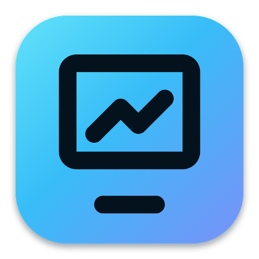
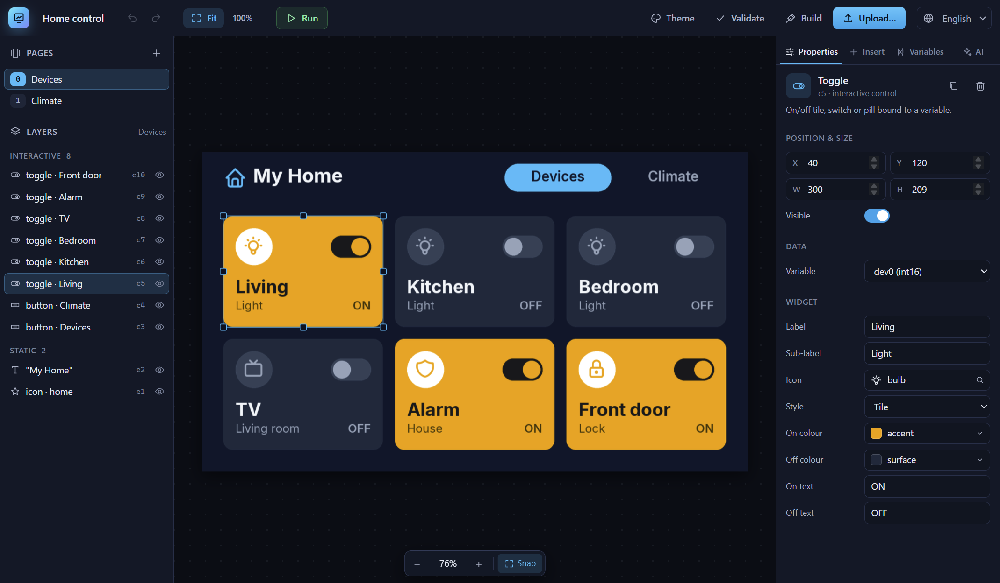
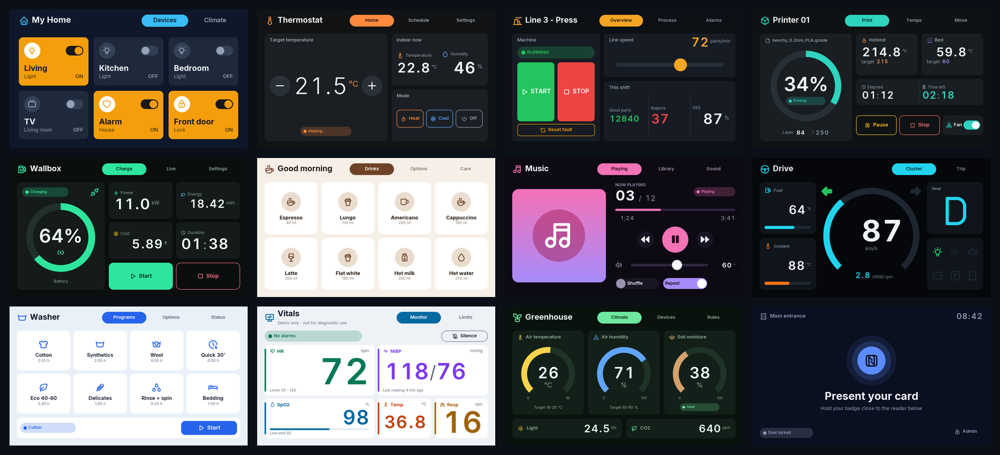
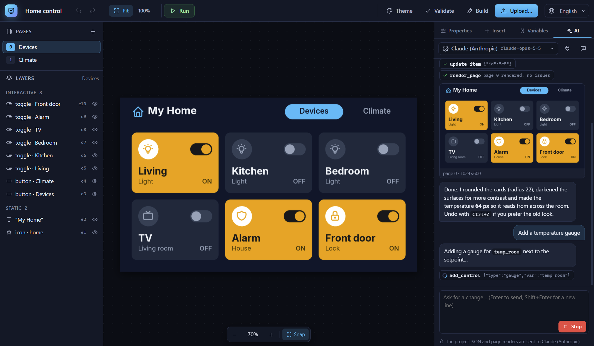
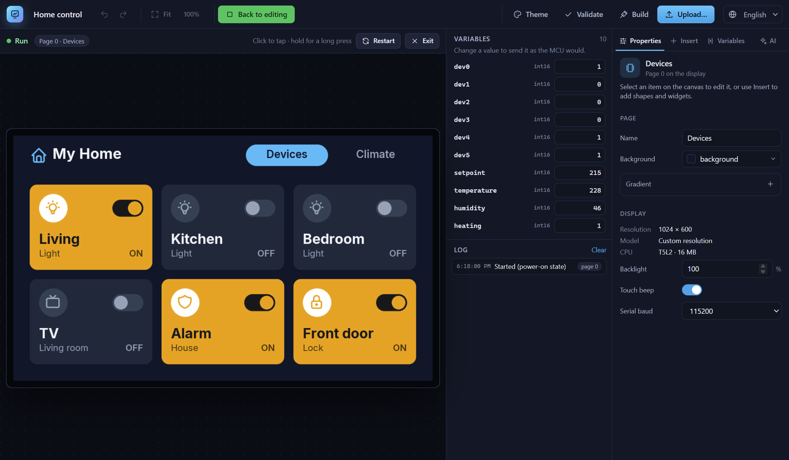

<div align="center">



# OpenDGUS

**The open-source designer for DWIN T5L (DGUS II) touch displays, with an AI designer built in.**

[](https://github.com/edward1987/opendgus/releases/latest)
[](https://github.com/edward1987/opendgus/actions/workflows/ci.yml)
[](LICENSE)


[**Download**](https://github.com/edward1987/opendgus/releases/latest) ·
[Features](#features) ·
[AI designer](#ai-designer) ·
[Your microcontroller](#talking-to-your-microcontroller) ·
[Build from source](#build-from-source)



</div>

DWIN's T5L displays are cheap, bright and capable, but the official DGUS tool is Windows-only, closed, and hard to
learn. Many of these displays end up in a drawer. **OpenDGUS replaces the whole workflow**: design the screens
visually (or ask an AI to), try them in an emulator, and flash them to the display over USB, all in one app.

## Features

| | |
|---|---|
| 🎨 **Visual editor** | Drag-and-drop pages, cards, text and icons, plus smart widgets: buttons, toggles, numbers, sliders, gauges, progress rings, indicators. The preview is pixel-exact. |
| ✨ **AI designer** | Describe the screen and the AI builds it, sees its own renders, and fixes what looks wrong. Works with Claude, OpenRouter, any OpenAI-compatible API, or local Ollama. |
| ▶️ **Emulator** | Click through your UI on the desktop, change variables like your MCU would, and watch the UART frames it sends, before you flash anything. |
| ⚡ **One-click upload** | Flash over the USB/UART adapter with a live progress bar, or export to a microSD card. Uses the exact timing of DWIN's own downloader. |
| 🖥️ **Any display** | 26 built-in DWIN models, part-number decoding (`DMG10600C070_03WTC` → 1024×600, 7", capacitive, 16 MB), or any custom resolution, in landscape or portrait. |
| 📐 **20 templates** | Responsive starting points that adapt to any resolution (see below). |
| 🔌 **MCU-ready** | Generates a `vars.h` with every variable address for your Arduino / STM32 / ESP32 firmware. |
| 🧰 **All 47 DGUS II controls** | For experts: every native control, byte-checked against the DGUS editor's own code. |
| 🌍 **English + Romanian** | Fully translated UI. |

## Templates

Twenty templates, each one responsive: pick any resolution and the layout adapts.



Home control · thermostat · industrial HMI · 3D printer · EV charger · coffee machine · music player ·
car dashboard · washing machine · vitals monitor · greenhouse · access control · weather station · solar monitor ·
elevator panel · PIN keypad · alarm panel · queue display · order kiosk · settings pages.
Details: [docs/reference/templates.md](docs/reference/templates.md).

## AI designer



Ask for a change in plain words: *"make this page more modern"*, *"add a temperature gauge"*,
*"build a 3-page coffee machine UI"*. The AI edits the project through the same tools the editor uses, renders the
page, looks at the result and corrects itself. Every change can be undone with `Ctrl+Z`.

- **Providers:** Claude (Anthropic), **OpenRouter** (hundreds of models, with prices shown), any OpenAI-compatible
  API (OpenAI, LM Studio, vLLM…), or **Ollama** running locally with no key at all.
- **Live model list:** paste your API key and the provider's models load into a searchable list, with the cost per
  million tokens when the provider reports it.
- **Your keys stay yours:** stored encrypted by your OS, sent only to the provider you picked.
- **MCP server:** use OpenDGUS from Claude Desktop, OpenAI Codex, Google Antigravity or any MCP client with the
  `opendgus-mcp` command. Setup: [docs/mcp.md](docs/mcp.md).

## Emulator



Press **Run** to try the UI: tap buttons, drag sliders, change variables the way your MCU would, and read the log
of frames the display would send on its UART.

## Getting started

1. **[Download](https://github.com/edward1987/opendgus/releases/latest)** the installer for your OS
   (Windows: `OpenDGUS-Setup-x.y.z-x64.exe`, or the portable `.exe` that needs no install).
2. Create a project: pick your display model (or type its part number) and a template.
3. Edit it, or open the **AI** tab and describe what you want.
4. Press **Run** to try it in the emulator.
5. Connect the display's USB/UART adapter, press **Upload…**, pick the COM port, and flash it.
   No adapter? **Build** writes a `DWIN_SET` folder you can copy to a FAT32 microSD card.

> [!NOTE]
> The builds are not code-signed yet. On Windows, SmartScreen may warn the first time: click
> **More info → Run anyway**. On macOS, right-click the app and choose **Open**.

## Talking to your microcontroller

Every build writes `vars.h` and `manifest.json` next to the `DWIN_SET` folder. Your firmware writes a variable with
one UART frame, and the display reports touches the same way:

```c
#include "vars.h"            // generated: #define VP_TEMPERATURE 0x5002 ...

// set "temperature" to 228 (22.8 °C): 5A A5 05 82 <VP hi> <VP lo> <value hi> <value lo>
void dgus_write(uint16_t vp, int16_t v) {
  uint8_t f[] = {0x5A, 0xA5, 0x05, 0x82, vp >> 8, vp & 0xFF, v >> 8, v & 0xFF};
  Serial1.write(f, sizeof f);
}

// a touch on a toggle arrives as: 5A A5 06 83 <VP hi> <VP lo> 01 <value hi> <value lo>
```

## How it works

```
project.json ─► compiler ─► DWIN_SET/ ─► SD card or UART ─► display
 (pages, widgets,   │          13.bin  touch controls
  variables, theme) │          14.bin  display controls
                    │          22.bin  initial variable values
                    │          32_pages.icl / NN_icons.icl  page images and widget art (JPEG)
                    │          T5LCFG.CFG  safe system options (never panel timing)
                    └─► vars.h + manifest.json for your MCU
```

Everything was reverse-engineered from the official tools and verified on a real display; the notes are in
[`docs/re/`](docs/re/). OpenDGUS contains no DWIN code.

## Command line

Everything the editor does is also available without it:

```bash
python -m opendgus.templates.home_control 800x480 my_screen   # project + build/DWIN_SET
opendgus-emu my_screen/build/DWIN_SET                         # try it on the desktop
opendgus-load ports                                           # find the display's COM port
opendgus-load upload my_screen/build/DWIN_SET -p COM3 --reset # flash it over UART
opendgus-load sd my_screen/build/DWIN_SET E:                  # or copy it to a FAT32/4 KB microSD
opendgus-load backup -p COM3 32 pages.icl                     # read a flash slot back
```

## Build from source

Requirements: Python 3.11+, Node.js 22+.

```bash
git clone https://github.com/edward1987/opendgus && cd opendgus
python -m venv .venv && .venv/Scripts/activate        # Linux/macOS: source .venv/bin/activate
pip install -e ".[dev,build]"

cd app && npm install && npm run dev                  # the desktop editor (it starts the Python backend itself)
```

Tests: `pytest` and `cd app && npm test`. CI runs both on Windows, macOS and Linux.

**Release build (Windows):** `.\build-release.ps1 -Version 1.2.3` runs the tests, builds the Python sidecar and the
installers, and writes them with checksums and release notes to `release\v1.2.3\`. Add `-Publish` to tag the
version and create the GitHub release. Pushing the tag also starts the release workflow, which adds the macOS and
Linux builds.

```
src/opendgus/   formats (all 47 controls, ICL, fonts, CFG) · model · compiler · widgets · render · emulator
                device (UART) · tools (shared by MCP, AI and editor) · ai · mcp_server · server · templates
app/            Electron + React editor
tests/          pytest (byte-exact vectors from DGUS's own C# code in tests/vectors)
tools/          csharp_harness (regenerates vectors from a local decompile), fetch_assets, gen_docs
packaging/      PyInstaller spec for the backend sidecar, app icons
```

## Reference

- [Smart widgets](docs/reference/widgets.md) · [DGUS controls](docs/reference/dgus-controls.md) ·
  [Templates](docs/reference/templates.md) · [Display profiles](docs/reference/displays.md)
  (generated by `tools/gen_docs.py`)
- [MCP / AI setup](docs/mcp.md) · [Reverse-engineering notes](docs/re/)

## Hardware notes

- The UART upload uses the exact sequence of DWIN's own downloader: it pauses the screen refresh and keeps it paused
  6 s after each block. Without that pause a display can lock up at boot, and only an SD card recovers it.
- Some units ship a rotated factory ASCII font, so OpenDGUS draws numbers with its own digit images by default.
- Controls marked "byte-matched to DGUS" haven't been tried on hardware yet. Reports and photos are welcome:
  [open an issue](https://github.com/edward1987/opendgus/issues).

## Contributing

Issues and pull requests are welcome, especially hardware reports from display models we haven't tested.
Please run `pytest` and `npm test` before sending a PR.

## License

GPL-3.0-or-later. Bundled: Inter font (SIL OFL 1.1) and Tabler Icons (MIT). DWIN and DGUS are trademarks of Beijing
DWIN Technology Co., Ltd.; this project is not affiliated with DWIN.
